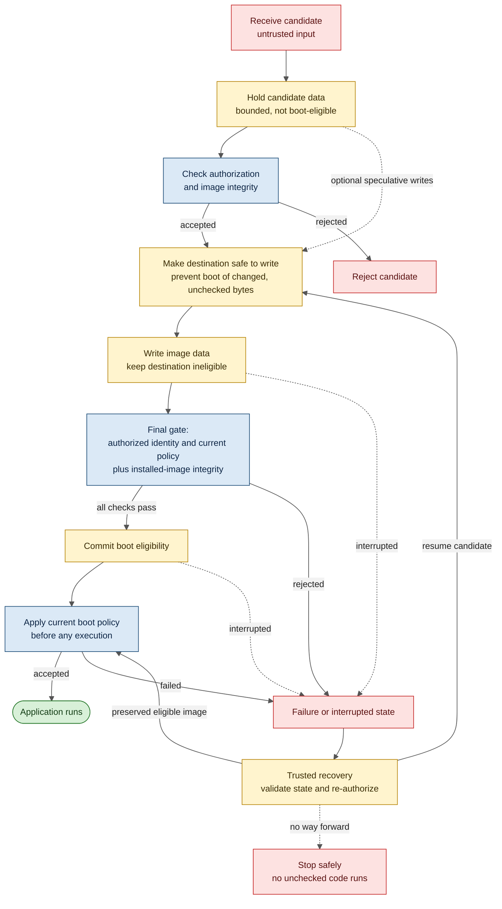
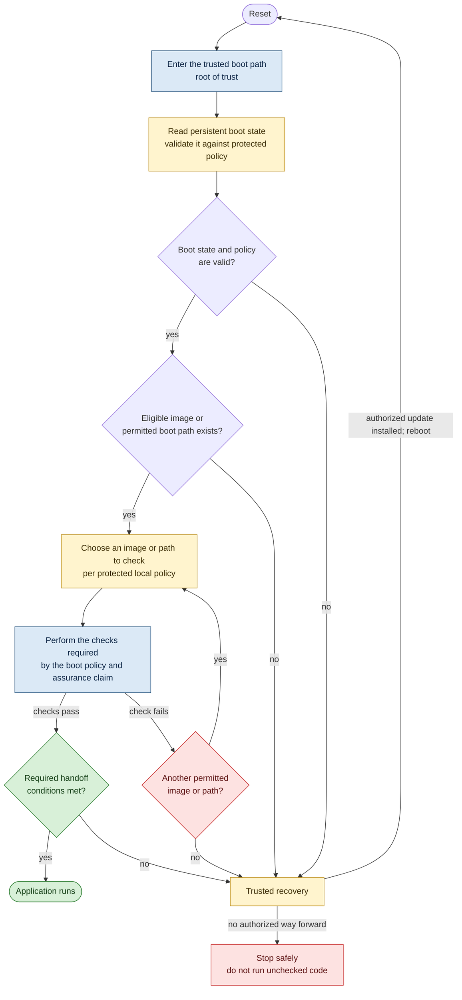

# Secure boot lifecycle

A firmware signature binds an image to a signing key. The device's policy decides whether to accept it. Neither answer tells the device when to erase flash, what to do after power loss, or when an installed image may run.

This document covers two connected operations for a microcontroller running one application: installing firmware and deciding what may run after reset. The boot decision applies on every reset, whether or not an update occurred.

Storage may hold an active image, a candidate or multiple slots. The model is independent of package format, transport and flash layout. Staging, inactive slots and streaming installation can all fit, but they make different promises about preserving the old application.

The [threat model](threat-model.md) describes the attacks and failures to consider. The [trust chain](trust-chain.md) defines the protection needed for a verified-boot claim. Sections 1–4 describe the update path and shared rules; [section 5](#5-the-boot-lifecycle) follows the boot decision from reset to handoff. SUF2's choices are mapped in [security-design.md](../security/security-design.md#update-lifecycle-in-suf2-v01); this generic model does not require SUF2 or its cryptographic suites.

## 1. Update decisions and terms

The terms below describe security decisions, not necessarily separate storage areas or program states.

- A **candidate** is incoming firmware and the metadata needed to interpret it. Receiving bytes does not make them trusted.
- **Authorization** means the candidate is accepted under the device's protected local policy, including its image identity, target and any required version or encryption rules. A valid signature alone is not enough.
- **Installation** writes the image into the storage from which it will run.
- **Boot eligibility** means installation is complete and the required checks have passed. It is not proof that the application works.
- **Recovery** is a trusted state or path that prevents unsafe boot when normal boot cannot proceed. It may offer a way to install another authorized image, but safe stopping alone does not promise that.
- **Durable** state survives reset and loss of power, within the storage system's stated guarantees. A **torn write** is a write interrupted before the whole record is stored.

The diagram shows decisions, not a required buffering strategy. Candidate data can be held in staging, written to an inactive slot or streamed in checked chunks. In every case it must stay bounded, and the update and boot paths must not select it for execution or execute it before the required checks pass.

Some designs write speculative, not-yet-authenticated data straight into an application destination. That can destroy the active image even if the candidate is later rejected, so the destination must first be made ineligible and independent trusted recovery must be usable before writing begins.

Whatever the route, the same final gate decides whether boot eligibility is committed. It may rely on a still-valid, protected earlier authorization result, but it must confirm the installed bytes. Later boot checks are not a substitute.

A reset can happen at any point, not just on the dashed arrows. Recovery validates stored state and re-authorizes before resuming at destination preparation; a fresh update starts again at reception. Rejection never authorizes a boot: a preserved image may run only if it still satisfies current boot policy.

### Example: power loss during an active-image update

1. The device has one eligible application, and the replacement has been fully authorized.
2. Before erasing the active image, the updater durably clears its eligibility. Independent trusted recovery is available.
3. Power fails halfway through installation. On restart, the boot path does not run the partial image and enters recovery.
4. Recovery validates the saved progress and candidate, repeats authorization under current policy, then resumes or restarts installation.
5. The final gate checks the installed image. Only then is boot eligibility committed; the next boot still applies its boot policy.

An inactive-slot design would instead leave the old image eligible while the new slot stays ineligible, so step 3 could fall back to the old image if it still satisfies current policy.

## 2. Rules shared by update and boot

An integration using this model MUST meet these requirements for the attacker capabilities it claims to resist.

1. **Input cannot choose its own authority.** Package fields may identify a key, target or destination, but protected local policy decides which keys, algorithms, regions and operations are permitted. Ordinary application updates cannot change the trust anchor, bootloader or security policy.
2. **Do not run an unchecked candidate.** The update and boot paths MUST NOT make candidate data eligible for execution before the required checks pass. This rule governs what the updater and bootloader may start. Hardware execute-never protection is separate and may also be required by the product's threat model.
3. **Check the bytes that will run.** Bind authorization to the exact image and its loading information. Authenticate data before writing it, or keep the destination ineligible while it changes. Recheck data if it can change before use.
4. **Persistent state cannot bypass checks.** Validate stored lengths, offsets, identifiers and progress before using them. Corrupted, stale or forged state must not authorize execution or writes to protected regions. A journal may help locate work to resume, but cannot replace image authorization.
5. **Keep the destination ineligible while it changes.**
   - *Before writing:* durably invalidate any existing boot-eligibility record for the destination, or ensure trusted boot-time checks reject changed bytes before execution. An inactive candidate destination stays ineligible without invalidating a preserved active image. If the update can leave no eligible image, independent trusted recovery must be available first.
   - *While writing:* the destination stays ineligible until the update is complete and checked.
   - *Committing:* make eligibility durable only after the final gate confirms authorization under current policy and installed-image integrity. A partly written eligibility or slot-selection record must resolve to a checked eligible image or safe recovery, never a partial image.
6. **Recovery preserves the security policy.** Failed checks, repeated resets and physical recovery entry do not grant permission to run unauthorized code or alter protected state. Any separately authorized maintenance operation needs its own policy.

Encryption is optional in this generic model. When used, unauthenticated decrypted output must not become executable or be exposed as trusted plaintext. A failed encrypted check must not fall back to a less restrictive acceptance mode.

## 3. From reception to boot eligibility

| Decision | What must be established | If it cannot be established |
| --- | --- | --- |
| Receive | Incoming data is bounded and held only in permitted candidate storage or destinations. | End reception. If destination preparation and installation have not changed stored state, leave the installed image and its eligibility unchanged. Otherwise, resolve the saved state under the interruption rules. |
| Authorize | Image identity, target and key satisfy protected policy; required encryption checks also pass. | Reject the candidate. A speculative write may precede this decision only while its destination remains ineligible. |
| Install | Writes are authenticated, or the destination stays ineligible; any eligible destination is made ineligible before it changes. | Keep it ineligible; resume after state validation or stop safely. |
| Final eligibility gate | Current authorization covers the candidate, and the installed bytes match its authenticated identity and loading information. | Do not commit eligibility; recheck, reject or recover. |
| Commit | Eligibility is durably associated with the checked image and its metadata. | Treat ambiguous state as uncommitted; stop safely or recover. |

## 4. Interruption and resumption

After reset, reconstruct the decision from stored bytes and trusted policy, not from a remembered success flag.

Reception and installation may overlap. Once destination preparation begins, apply the rules for the destination's state, even if reception is incomplete. Eligibility may already have been cleared before any image bytes were written.

| Interruption point | Safe next step |
| --- | --- |
| During reception or authorization | Discard incomplete input, or resume under bounded rules and repeat the necessary checks. |
| During destination preparation | Resolve any interrupted eligibility change using validated state. Intact image bytes do not by themselves restore eligibility. |
| During installation | Keep partial image data ineligible. Validate progress and re-authenticate the candidate before resuming writes, or recover. A preserved image may run only if it still meets current boot policy. |
| After the final eligibility gate, before commit | Repeat the required checks or establish that the checked bytes and decision remained protected; only then commit eligibility. |
| During commit | Resolve torn state using the documented storage mechanism and required image checks. If state is ambiguous, recover rather than guess. |
| During boot checks or handoff | Restart the boot decision. Apply the trust-chain protection from checking to execution. |

Resumption must also keep updates separate. A new package cannot inherit another candidate's progress or authorization. If local policy changes between interruption and restart, the resumed candidate must satisfy the policy now in force. Where policy or version rollback resistance is claimed, integrity alone is insufficient: the design must also establish freshness.

## 5. The boot lifecycle

The update process above describes how an image becomes eligible to boot. Boot eligibility records that installation checks completed; it does not replace checks required at boot or, by itself, establish verified boot. This section follows the device from reset through choosing an image to check, applying required checks and handing off. It describes the sequence, not a particular bootloader or storage layout.

### From reset to handoff

The diagram is a logical sequence, not a promise that every device has multiple images or a recovery installer. If no other permitted path exists, stopping safely is a valid outcome.

### What each step establishes

| Step | Decision | If it cannot be established |
| --- | --- | --- |
| Start | A protected root of trust begins the boot path. Later boot stages are trusted only through the chain defined by the platform. | Do not continue into an untrusted stage. Use only a separately authorized path, if one exists. |
| Read state | Slot selection, eligibility records, recovery requests and other saved data are checked before use. They help describe device state; they do not grant permission to run code. | Use trusted recovery or stop safely if state is invalid or ambiguous. Never treat a progress or success flag alone as authorization. |
| Select for checking | Protected local policy determines which image or alternate boot path may be examined. Package fields, application requests and recovery buttons cannot grant themselves authority. | Choose another path only if policy permits it; otherwise recover or stop. |
| Check | Apply the checks required by the product's stated boot policy and assurance claim. A verified-boot claim requires verification on every boot path reachable to the attacker in scope; narrower claims may provide less. | Do not start the image or stage that failed. Any fallback must meet the same policy for its path. |
| Handoff | The bytes checked are the bytes the processor starts. | If any required handoff condition is missing, do not transfer control; try another authorized path or stop safely. |
| Continue or stop | Recovery remains trusted and follows the same authorization policy. | If no authorized path forward exists, stop without running unchecked code. |

A platform that cannot protect the checked bytes through handoff as required by the [trust-chain requirements](trust-chain.md#2-requirements-for-a-verified-boot-claim) must not claim verified boot.

### Failure, fallback and recovery

A failed check is a rejection of that image or path, not permission to relax policy. The device may try another image or path only when local policy already allows it. Recovery must not start code outside the trusted boot chain or code that local policy does not authorize. An update request does not grant authorization.

Trusted recovery may install or receive a new candidate, but that candidate follows the update process in sections 1–4: it must be authorized, installed safely and made eligible before it can be selected to run. Recovery does not promise that another image is available or that installation will succeed.

### Boundaries

This lifecycle ends at application handoff. It does not define application health or runtime protection, rollback resistance, bootloader updates or key transitions. Those properties need separate policies and evidence.

## 6. State the availability promise

A failed update must never make an unchecked image runnable; that is the baseline. If no eligible image remains, the device may stop application execution or enter trusted recovery; this safe stop alone does not promise that another image can be installed. Integrations must state which additional availability guarantees they provide and under what conditions. Both can apply.

| Promise | What it means |
| --- | --- |
| Recoverable installation | If normal boot is unavailable, a protected recovery path can accept another authorized image when power, storage and a usable delivery path are available. |
| Previous-image preservation | A failed or interrupted update leaves a previously eligible image available under current policy. This needs a storage and selection design that actually preserves it. |

Recovery is not unlimited availability. A hostile transport, exhausted flash, lost authorization keys or unavailable power can still prevent recovery.

## 7. Evidence to record

For each integration, document:

- Which logical decisions correspond to state that must survive reset, and who may modify it.
- What is authenticated before each write, what is checked afterwards, and how checked data remains unchanged until use.
- The storage layout, erase boundaries and commit mechanism, including behavior after torn writes.
- How interrupted sessions are resumed or discarded without mixing candidates or trusting journal fields as authorization.
- Which image may run after each failure, and how recovery remains trusted and reachable.
- The boot stages, selection policy, checks on each reachable path, recovery authority and protection from verification through handoff.
- The availability promise, attacker capabilities and any freshness or application-health policies.

Exercise resets and storage failures around every durable transition, including repeated interruptions during recovery. Corrupt or replay progress and eligibility records, replace candidate data between checking and use, and try a different candidate during resumption. The expected result must follow from the stated policy, not merely from whatever the implementation happens to do.
