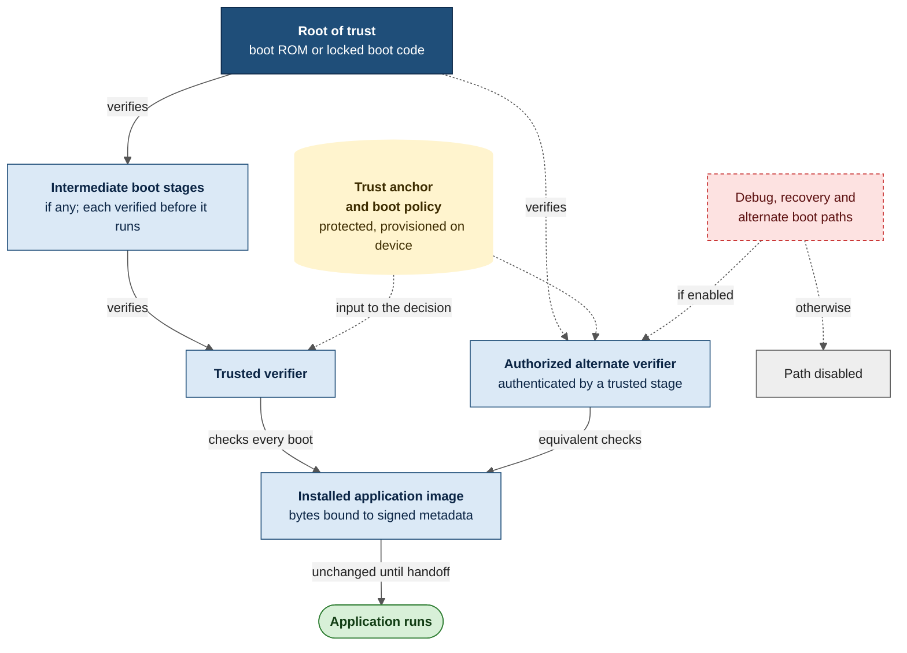

# Secure boot trust chain

Secure boot controls which code a device starts, according to its protected boot policy. That depends on the whole path from a hardware starting point to the application, not on signatures alone. A signature shows that a particular key signed some data. It says nothing about who controlled the key, and nothing about whether the device will actually check it.

This page describes a platform-independent, signature-based trust model for secure boot. It does not define a bootloader, and it does not claim that SUF2 supplies a hardware root of trust. How SUF2 maps onto these requirements is in [security-design.md](../../security/security-design.md); notes on specific boards are in [platform-integration.md](../../security/platform-integration.md).

A few terms used throughout:

- **Attacker in scope:** an attacker with the capabilities a claim says it resists. Requirement 8 says to list those capabilities.
- **Root of trust:** the starting point the device relies on to verify later stages. Its original code and configuration must be established through trusted manufacture or provisioning, then protected against the attacker in scope. It may be boot ROM or a bootloader locked against the attacker in scope.
- **Boot stage:** any code that runs before the application and can influence what runs next. A **mutable** stage is one that can be changed after manufacture, for example a bootloader stored in ordinary flash.
- **Trust anchor:** the public key, or a hash of it, that the verifier uses to decide which signatures to accept.
- **Digest:** a fixed-length value produced by a cryptographic hash; here, it identifies the image bytes covered by the signature.
- **Boot policy:** the other local settings that govern the decision, such as allowed algorithms, product identity, permitted memory regions and which recovery routes are allowed.

## 1. The chain

Read the diagram from top to bottom. Each stage is trusted because the stage before it verified it, or because it is the root of trust and is protected against the attacker in scope.

Sometimes the root of trust *is* the bootloader—for example, when it runs from ROM or flash locked against the attacker in scope. In that case, there are no intermediate stages.

The trust anchor and boot policy are inputs to the verifier, not stages that run. They matter just as much, though: whoever can change them decides what the device accepts.

An attacker who can replace a stage, change the trust anchor or policy, bypass a check, or alter the image after verification may cause the device to run code its policy did not authorize.

For example, if holding a recovery button starts unsigned code, signing every normal update does not give the device verified boot.

## 2. Requirements for a verified-boot claim

A platform integration that claims verified boot MUST meet all of the following.

1. **Verify every boot stage.** Every piece of code that runs before the application and can affect the boot decision is either the root of trust or is verified by an earlier trusted stage before it runs. Protecting a stage from writes is not the same as verifying it. If the root of trust is a locked bootloader rather than ROM, state how its code and configuration became trusted.
2. **Protect the trust anchor and policy.** They are provisioned through a trusted process and cannot be changed by the attacker in scope. Private signing keys are never stored on the device.
3. **Account for every boot path.** Debug access, recovery modes, alternate boot sources and ROM download modes must either provide equivalent authorization and integrity guarantees under protected local policy, or be disabled against the attacker in scope. A trusted recovery path may use a different verifier or key if policy explicitly allows it. Any path that can start code the policy did not authorize invalidates the claim.

   For example, a ROM download mode that lets the attacker in scope run unsigned code from RAM must be locked out.
4. **Bind each checked image to authenticated metadata.** For every boot stage and application image verified by an earlier stage, authenticated metadata must identify at least the image's digest and length, plus anything else that changes how it is loaded or started. On every boot, the verifying stage checks the metadata signature and compares the installed bytes with that authenticated identity before the image runs.

   A metadata signature paired with a separate, unsigned checksum does not authenticate the image. Checking only when an update is installed is not verified boot.
5. **Keep each checked stage unchanged until it runs.** A stage verified by earlier code must remain unchanged from verification until execution begins. The same applies to the application: the bytes checked must be the bytes the processor starts at handoff. If the integration cannot guarantee this, it MUST NOT claim verified boot. Keeping code unchanged after the application starts is a separate runtime property; see section 4.
6. **Make target and identity decisions locally.** A package may say which product it is for or where it expects to be loaded. The device's own protected policy decides whether that is acceptable and where bytes actually go.
7. **Fail closed.** If any stage or image fails verification, that code does not run. Recovery is subject to requirement 3.
8. **State what the claim covers.** List the attacker capabilities the integration resists, the ones it does not, and the evidence for each.

## 3. Assurance labels

Use the label that matches what the device actually guarantees. The two are not interchangeable.

| Label | What it means |
| --- | --- |
| **Authenticated update** | The update path only accepts packages signed by a trusted key and allowed by local policy. It does not promise that the installed image is checked on every boot, or that other boot paths apply the same rules. |
| **Verified boot** | Every boot path reachable by the attacker in scope ends at a trusted verifier: either the root of trust or a verifier authenticated by an earlier trusted stage. It checks the installed image against protected local policy on every boot, and the checked bytes are the bytes that start running. |

A verified-boot claim applies to the whole device for the attacker in scope. You can make a narrower claim, such as authenticated update, but do not call it verified boot while a reachable bypass exists.

Encryption is a separate concern. Encryption alone does not establish a trusted boot chain, even when it detects tampering: the device still needs a trusted verifier and protected policy to decide what may run.

## 4. What verified boot does not give you

Verified boot is about what starts. On its own it does not provide:

- Protection against rollback: an older image that was once authorized may still be accepted, unless the device separately enforces version freshness.
- Safety of authorized code: verified boot proves that the image matches what a trusted key authorized, not that the image is safe or free of vulnerabilities. A compromised signing key can authorize malicious code until that key is revoked or replaced.
- Key revocation or rotation: these need their own mechanism, including a safe way to recover if a key change goes wrong.
- Confidentiality: signed firmware may still be readable in transit and in storage.
- Runtime protection: once the application starts, verified boot does not stop it from misbehaving, being exploited, or changing code that is already running. Keeping running code unchanged needs runtime controls such as memory protection.
- Availability: an attacker may still interrupt updates or block access to recovery.
- Remote assurance (attestation): verified boot does not by itself let a remote party confirm which software booted. That requires measured boot (recording a hash of each stage as it starts) and an attestation mechanism.

If a product needs any of these, state them as separate claims.

## 5. Evidence for an integration

For each platform and product configuration, record:

- The boot sequence from reset to application, and which stage verifies which.
- Where each boot stage, the trust anchor and the boot policy are stored, and how each is protected and provisioned.
- Every debug, recovery, ROM, alternate-boot and update path, and what each one checks.
- What the signed metadata covers, and how the installed bytes are checked against it.
- How the checked bytes are kept unchanged until the handoff to the application.
- The flash layout, and which code can write each boot stage, the trust anchor, the policy, the image and any recovery state.
- What happens after a failed check, an interrupted update or an unavailable recovery path.
- The assurance label, the attacker capabilities covered and excluded, and the evidence for each.

Chip documentation alone does not prove a product claim. Check the fuses, lock bits, boot configuration and recovery behavior on the actual device.

## 6. Key handling

- Generate signing keys offline. Keep private keys out of the repository, off the device and out of command-line arguments.
- Provision the public keys used to verify firmware signatures, or protected hashes of those keys, on devices. Handle device-encryption and identity keys under their own trust policies.
- If a device trusts more than one key, document which key is used for what and how a key is retired.
- Label test keys clearly and make sure production configurations reject them.
