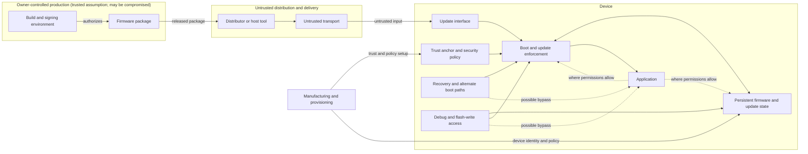

# Firmware update and secure boot threat model

This document describes threats to firmware update and boot on microcontroller-class devices. It describes the problem, not a particular product's solution. The threat-to-SUF2 mapping is in [security-design.md](security-design.md).

## Scope

In scope:

- A device that receives a firmware package, decides whether it is authorized, changes persistent firmware state, and decides what code may run after reset.
- A single application image per device. The device may use staging, inactive slots, streaming installation, execute-in-place, or another architecture.
- Delivery over any transport, including USB, serial, network or radio. The delivery path is untrusted.
- Trust-anchor and security-policy provisioning, bootloader updates, recovery paths, and host-side package handling where they can affect what the device accepts or runs.

Out of scope:

- The running application's behavior, data security and vulnerabilities, except where a compromised application can affect update or boot security.
- Multi-image or multi-processor update orchestration and update campaign management.
- The security of general-purpose network protocols used for delivery, such as TLS or device pairing.

## System model

The following is a **logical reference model**, not a required installation sequence or storage layout. Verification may happen before, during or after writing an inactive image; the security requirement is that only authorized, intact state is used to make an execution decision.

| ID | Trust boundary | Why it matters |
| --- | --- | --- |
| B1 | Update sender to device update interface | Anything can arrive over the update path |
| B2 | Distributor or host to update sender | Packages pass through systems the owner may not control |
| B3 | Build and signing environment | Whoever controls production and signing can influence authorized firmware |
| B4 | Boot/update enforcement to application | A compromised application may attack protected update state |
| B5 | Firmware and update state to boot decisions | Persistent data can change between checks and use |
| B6 | Debug, recovery and alternate boot paths | These may bypass the normal enforcement path |
| B7 | Manufacturing and provisioning to device | Incorrect or malicious initial trust material can invalidate later checks |

## Assets

| ID | Asset | Why it matters |
| --- | --- | --- |
| AS1 | Signing private key | Possession allows firmware to be authorized |
| AS2 | Device trust anchor | Determines which signer the device trusts |
| AS3 | Bootloader and boot/update enforcement code | Replacing it can remove or bypass checks |
| AS4 | Installed firmware and its authorization metadata | Determines what code is eligible to run |
| AS5 | Firmware package in transit | May contain confidential code |
| AS6 | Device-side decryption key, where used | Exposure may reveal packages encrypted to it |
| AS7 | Device availability and flash lifetime | Determines whether the device can continue to boot and be updated |
| AS8 | Persistent update state | May include staging data, slot state, progress records or a journal; it drives installation and recovery decisions |
| AS9 | Device security configuration and policy | Includes product identity, permitted destinations, allowed keys, algorithm policy, encryption requirements, boot/recovery policy, firmware-version state and key-revocation state |
| AS10 | Provisioning records and process integrity | Establishes the intended trust anchor and security configuration for each device |

## Attackers and failure sources

| ID | Attacker or source | Capability |
| --- | --- | --- |
| A | Update-interface attacker | Can send arbitrary, malformed, partial, repeated or oversized data to an exposed update interface; has no assumed debug or flash access |
| B | Distribution-path attacker | Can modify, swap, withhold or replay packages before delivery |
| C | Compromised host | Controls a computer or gateway that handles or delivers packages; does not necessarily hold a signing key |
| D | Compromised application | Runs code through a flaw in legitimately installed firmware and may attempt to alter update state |
| E | Physical attacker | Can access the device, interrupt power, read/write flash, or use debug and boot ROM interfaces where available |
| F | Signing-environment attacker | Controls a signing key or compromises build/release systems to authorize malicious firmware |
| G | Manufacturing/provisioning attacker | Can cause an incorrect trust anchor or security policy to be provisioned |
| N | Non-adversarial failure | Includes operator mistakes, component faults, accidental power loss and package-producer errors |

These are capability scenarios, not automatic bundles. Update-interface access alone does not imply arbitrary flash-write access. Physical access does not necessarily mean debug is unlocked or that an immutable hardware root can be changed. State which capabilities apply to a deployment before using this model to make a security claim.

## Security objectives

These are goals for a secure update and boot design. A design should identify which goals it meets, depends on the platform to meet, or does not address.

| ID | Objective |
| --- | --- |
| O1 | **Authenticity:** only firmware authorized by the firmware owner is installed or started |
| O2 | **Integrity:** changes to firmware, authorization metadata or security-relevant update state are detected before that state is trusted or used |
| O3 | **Applicability:** firmware and policy apply only to the intended device, product and permitted memory region |
| O4 | **Freshness:** an older authorized version cannot replace a newer one unless explicitly permitted |
| O5 | **Key lifecycle:** compromised or retired authorization keys can be revoked or replaced safely |
| O6 | **Confidentiality in transit:** firmware content is not disclosed while being delivered |
| O7 | **Confidentiality at rest:** firmware content is not disclosed from device storage |
| O8 | **Safe installation:** unauthorized or partial code is never made runnable during or after an update |
| O9 | **Receiver robustness:** hostile update input cannot corrupt the update/boot enforcement component or its control flow |
| O10 | **Root-of-trust protection:** enforcement code, trust anchors and security policy cannot be replaced or bypassed by the stated attacker |
| O11 | **Runtime containment:** a compromised application cannot modify protected update state or subvert later boot decisions |
| O12 | **Recoverability and availability:** after a failure or interruption, the device can return to a working, updatable state; repeated requests cannot permanently exhaust device resources |
| O13 | **Device-secret confidentiality:** cryptographic keys and other protected secrets held on the device are not disclosed |
| O14 | **Host-tool robustness:** hostile packages cannot compromise tools that create, inspect or deliver firmware |

## Impact ratings

Impact is rated **H**igh, **M**edium or **L**ow if a threat succeeds on a general-purpose device:

- **High:** unauthorized firmware runs; enforcement code, trust anchors, security policy or device secrets are compromised; significant sensitive data is exposed; or the device is permanently lost.
- **Medium:** recoverable loss of update availability, reversible firmware disruption, or limited confidentiality loss.
- **Low:** bounded resource use or temporary inconvenience.

Availability impact can be **High** where a device or fleet is stranded on known-vulnerable firmware, flash lifetime is exhausted, or recovery is not available. Likelihood depends on deployment and is not rated.

## Threat derivation and coverage

Threats were identified by examining each trust boundary and asset, then screening the results against STRIDE: **S**poofing, **T**ampering, **R**epudiation, **I**nformation disclosure, **D**enial of service and **E**levation of privilege. This is a coverage check, not proof that the catalogue is exhaustive. Repudiation is included where auditability or attribution matters; this profile does not define an audit-log objective, so no standalone repudiation threat is listed.

| Boundary | S | T | R | I | D | E |
| --- | --- | --- | --- | --- | --- | --- |
| B1 Update interface | U1, K6 | U2–U4, U6, U10, K7 | — | U9, U11 | U7, P13 | U5, U12, K7 |
| B2 Distribution and host | H2, H3 | H1–H3 | — | H6 | H4 | H5 |
| B3 Build and signing | K1–K3 | K2, K5, K7 | — | K1 | K9 | K2, K7 |
| B4 Enforcement/application | X1 | X2 | — | — | X1 | X2, X3 |
| B5 Persistent state | K8 | U8, P1, P8, P10, P11, P14 | — | K4, P4 | P5, P6, P13, K9 | P1, P8, P11, P14 |
| B6 Debug/recovery/alternate boot | P9, P12 | P2, P3, P9, P12, P14 | — | P4, P7 | P5, P13 | P2, P3, P9, P12, P14 |
| B7 Manufacturing/provisioning | P10 | P10 | — | — | — | P10 |

## Threats

Attacker/source IDs are defined above. A dash means the threat may arise from a non-adversarial failure as well as an attack.

### Update input and receiver (B1; attackers A, C)

| ID | Threat | Objective | Attacker/source | Impact |
| --- | --- | --- | --- | --- |
| U1 | Unsigned or wrongly authorized firmware is accepted | O1 | A, B, C, F | H |
| U2 | Firmware or its authorization metadata is altered without detection | O2 | A, B, C | H |
| U3 | Parts of distinct packages are combined into one accepted update | O2, O8 | A, C | H |
| U4 | Truncated, duplicated, reordered or conflicting package parts cause incorrect assembly or acceptance | O2, O8 | A, C | M |
| U5 | Malformed input exploits the receiver or enforcement component | O9 | A, C | H |
| U6 | Package-controlled metadata redirects writes outside the permitted destination | O3, O10 | A, C | H |
| U7 | Oversized, endless or repeatedly failing transfers exhaust resources or prevent normal update operation | O12 | A, C | M |
| U8 | Update candidate data or state changes after update-time verification but before installation or commit | O2, O8 | A, D, E | H |
| U9 | Device keys or other protected secrets are exposed through responses, status or update interfaces | O13 | A, C | H |
| U10 | Security configuration or policy is altered, such as clearing an encryption requirement or changing permitted destinations | O2, O3, O10 | A, D, E | H |
| U11 | Error differences or timing reveal secret-dependent information to a remote observer | O6, O13 | A, B, C | H (M for limited leakage without secret recovery) |
| U12 | A normal update-mode request or update-interface command bypasses authorization or grants privileges | O1, O9, O10 | A, C, D | H |

### Distribution and host (B2; attackers B, C)

| ID | Threat | Objective | Attacker/source | Impact |
| --- | --- | --- | --- | --- |
| H1 | A package is modified in transit | O2 | B, C | H |
| H2 | An older, genuinely authorized package is replayed to downgrade the device | O4 | B, C | H |
| H3 | A package for another product or board is installed | O3 | B, C | M |
| H4 | Updates are withheld or deleted, leaving devices on old firmware | O4, O12 | B | M (H if the frozen version is known-vulnerable) |
| H5 | A malicious package compromises a host tool that creates, inspects or delivers firmware | O14 | B, C, F | H |
| H6 | An encrypted package still reveals metadata such as size, digests or key identifiers | O6 | B, C | L |

### Signing, key lifecycle and policy (B3, B5; attackers B, F, G; source N)

| ID | Threat | Objective | Attacker/source | Impact |
| --- | --- | --- | --- | --- |
| K1 | A signing key is stolen or misused | O1, O5 | F, N | H |
| K2 | Malicious firmware is built and authorized through a compromised release process | O1 | F | H |
| K3 | A test or development key is trusted by production devices | O1, O10 | F, G, N | H |
| K4 | A shared device-side decryption key is extracted and exposes protected material | O6, O13 | E, F | H |
| K5 | The package producer accidentally or deliberately reuses an encryption nonce under the same key | O2, O6 | F, N | H |
| K6 | A key supplied by an untrusted package is treated as a trust anchor | O1, O10 | A, B, C | H |
| K7 | Algorithm confusion or downgrade enables a weaker or unauthenticated mode | O1, O2 | A, B, C, F | H |
| K8 | A key that has been revoked or retired continues to authorize firmware | O1, O5 | B, F, N | H |
| K9 | A valid key transition leaves the device with no usable authorized key for future updates | O5, O12 | F, N | M (H if recovery is unavailable) |

### Application and enforcement (B4; attacker D)

| ID | Threat | Objective | Attacker/source | Impact |
| --- | --- | --- | --- | --- |
| X1 | An application repeatedly requests update mode to deny normal operation | O12 | D | M (L for brief inconvenience) |
| X2 | A compromised application modifies protected firmware, update state, enforcement code or policy | O2, O10, O11 | D | H |
| X3 | An update-mode request or application-to-loader interface grants privileges beyond selecting an update path | O9, O10, O11 | D | H |

### Persistent state, provisioning and physical access (B5–B7; attackers E, G; source N)

| ID | Threat | Objective | Attacker/source | Impact |
| --- | --- | --- | --- | --- |
| P1 | Installed firmware or its authorization metadata is modified after installation | O2 | D, E | H |
| P2 | Enforcement code or the trust anchor is replaced outside an authorized update path | O1, O10 | D, E | H |
| P3 | Firmware is swapped after boot-time verification but before or during execution | O2, O8 | D, E | H |
| P4 | Firmware is read from device storage | O7 | E | M |
| P5 | Power loss, reset or link interruption leaves unauthorized or partial code runnable, or prevents recovery | O8, O12 | A, E, N | H (M for recoverable availability loss without unsafe execution) |
| P6 | Authorized but faulty firmware repeatedly fails to boot and prevents recovery | O12 | F, N | M |
| P7 | Side channels or fault injection defeat checks or disclose device secrets | O1, O10, O13 | E | H |
| P8 | Persistent update or recovery state is forged or corrupted to skip checks or make an unsafe transition | O2, O8, O10 | D, E, N | H |
| P9 | Debug access or an alternate boot path starts unverified code or bypasses enforcement | O1, O10 | D, E | H |
| P10 | Manufacturing or provisioning installs the wrong trust anchor, device identity or security policy | O1, O3, O10 | G, N | H |
| P11 | The bootloader-update path accepts an unauthorized or older enforcement component | O1, O4, O10 | B, C, D, E, F | H |
| P12 | A recovery interface is abused to bypass normal authorization or gain control of protected state | O1, O9, O10 | A, D, E | H |
| P13 | Repeated writes exhaust flash endurance and make the device unable to update or boot | O12 | A, C, E, N | M (H if unrecoverable) |
| P14 | An older but authentic version or key-policy state is restored, re-enabling a revoked key or lower firmware version | O4, O5, O10 | D, E, N | H |

## Reporting problems

Think the model misses a threat? Please open an issue or a pull request. New threats receive new IDs; existing IDs are never reused. Update the STRIDE coverage matrix whenever boundaries or threats change.
