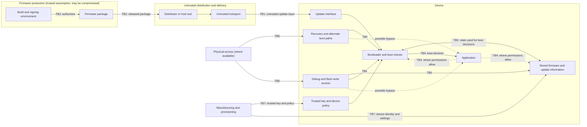

# Firmware update and secure boot threat model

**Status:** Design review draft | **Last reviewed:** 2026-11-27 | **Threat mapping checked against:** SUF2 v0.1 in [security-design.md](security-design.md)

Secure boot decides which code a device may run. Firmware updates must also decide which code to accept and how to install it safely.

This model covers both. It considers hostile update files, compromised delivery systems, stolen keys, interrupted updates and attacks on the device itself. It describes what can go wrong, not which problems SUF2 solves. The SUF2 response is in [security-design.md](security-design.md).

## Scope

This model is for microcontroller-class devices with one application image. It covers the path from preparing and delivering firmware through the device's decision to install and run it. The device may use staging, inactive slots, streaming installation, execute-in-place or another design; this document does not require a particular layout.

Delivery may use USB, serial, network or radio. The delivery path is treated as untrusted. Provisioning, bootloader updates and recovery paths are included when they can affect what the device accepts or runs.

This model does not cover the application's general behavior or data security, multi-image or multi-processor update orchestration, update campaign management, or the security of general-purpose network protocols such as TLS and device pairing. A compromised application is considered only where it can affect update or boot security.

## How update and boot fit together

A **bootloader** is the code that runs before the application and decides whether the application may start. It uses a trusted key or equivalent information to decide which firmware is authorized. The package may pass through a build system, a download service and a computer before reaching the device.

The diagram shows the main parts and where trust can break. It is a reference model, not a required installation sequence. In particular, verification may happen before, during or after writing an inactive image.

For example, someone who can send data over an exposed USB update port can feed malformed input to the receiver (U5). That access alone does not mean they can write arbitrary flash or replace the bootloader (P2, P9).

The threat tables use short codes for attackers and security goals. Select the [Attacker/source](#attackers-and-failure-sources) or [Objective(s)](#security-objectives) column heading to see what those codes mean. Each threat also has a stable ID for discussion and cross-reference.

## Threats

### Update input and receiver

An update file does not have to be valid to be dangerous: malformed input can target the receiver itself. Even well-formed data can be risky if it points to the wrong memory or changes after it has been checked.

| ID | What could go wrong? | [Objective(s)](#security-objectives) | [Attacker/source](#attackers-and-failure-sources) | Impact if it succeeds |
| --- | --- | --- | --- | --- |
| U1 | The device accepts firmware that the authority designated by its trust policy has not approved | O1 | A, B, C, F | H |
| U2 | Firmware or the information used to authorize it is changed without detection | O2 | A, B, C | H |
| U3 | Parts of different firmware packages are combined into one accepted update | O2, O8 | A, C | H |
| U4 | Missing, repeated, reordered or conflicting package parts cause the wrong image to be assembled or accepted | O2, O8 | A, C | H if unauthorized code runs; M for recoverable disruption |
| U5 | Malformed input exploits the receiver or bootloader | O9 | A, C | H |
| U6 | Package data makes the device write outside its permitted memory region | O3, O10 | A, C | H |
| U7 | Endless, oversized or repeated failed transfers exhaust resources or keep the device from normal operation | O12 | A, C | M |
| U8 | Update data changes after it is checked but before it is installed or committed | O2, O8 | A, D, PH2 | H |
| U9 | A device key or other protected secret leaks through an update response, status report or interface | O13 | A, C | H |
| U10 | Device settings that govern security are changed, such as allowed keys, destinations or encryption requirements | O2, O3, O10 | A, D, PH2 | H |
| U11 | Error messages or timing reveal secret-dependent information to someone observing the update path | O6, O13 | A, B, C | H if a secret can be recovered; M for limited leakage |
| U12 | An unauthenticated command on the normal update interface skips authorization or changes protected update state | O1, O9, O10 | A, C | H |
| U13 | The receiver trusts unauthenticated metadata or plaintext to authorize installation, change protected policy or make code runnable | O1, O2, O8, O10 | A, B, C, D, PH2 | H |

### Distribution and host tools

A download service can replay a genuine old package just as easily as it can supply a modified one. A malicious package can also exploit a bug in the tool that opens or inspects it. The device's signature checks do not protect that computer.

| ID | What could go wrong? | [Objective(s)](#security-objectives) | [Attacker/source](#attackers-and-failure-sources) | Impact if it succeeds |
| --- | --- | --- | --- | --- |
| H1 | A package is changed while it is being delivered | O2 | B, C | H |
| H2 | An older, genuinely authorized package is replayed to downgrade the device | O4 | B, C | H |
| H3 | Firmware for another product or board is installed | O3 | B, C | H if the wrong image runs; M if rejected before execution |
| H4 | Updates are withheld, leaving devices on old firmware | O4, O12 | B | M; H if devices are left on known-vulnerable firmware |
| H5 | A malicious package compromises a computer or tool used to create, inspect or deliver firmware | O14 | B, C, F | H |
| H6 | An encrypted package still reveals details such as its size, digests (cryptographic hashes) or key identifiers | O6 | B, C | L; M if it confirms a guessed image |

### Signing and keys

A stolen signing key or compromised release pipeline can put malicious firmware inside a correctly signed package. A key may also remain trusted after the authority responsible for it has retired it.

| ID | What could go wrong? | [Objective(s)](#security-objectives) | [Attacker/source](#attackers-and-failure-sources) | Impact if it succeeds |
| --- | --- | --- | --- | --- |
| K1 | A signing key is stolen or misused | O1, O5 | F, N | H |
| K2 | A compromised release process signs malicious firmware with a trusted key | O1 | F | H |
| K3 | A test or development key is trusted by production devices | O1, O10 | F, G, N | H |
| K4 | A product- or fleet-shared firmware decryption key is exposed, revealing packages encrypted for that group | O6, O13 | D, F, PH2, PH3 | H |
| K5 | The package producer accidentally or deliberately reuses an encryption nonce (a value that must not repeat with the same key) | O2, O6 | F, N | H |
| K6 | The device trusts a key supplied by an untrusted package | O1, O10 | A, B, C | H |
| K7 | Algorithm confusion or downgrade makes the device use a weaker or unauthenticated method | O1, O2 | A, B, C, F | H |
| K8 | A key that the trust-policy authority has revoked or retired is still accepted by the device | O1, O5 | B, F, N | H |
| K9 | A key change removes the last key the device trusts, so it can no longer accept updates | O5, O12 | F, N | H if no recovery is possible; M otherwise |

### Application and bootloader

Passing boot checks does not guarantee safe behavior after the application starts. Bugs or malicious behavior in an authorized application can still target update and boot state.

| ID | What could go wrong? | [Objective(s)](#security-objectives) | [Attacker/source](#attackers-and-failure-sources) | Impact if it succeeds |
| --- | --- | --- | --- | --- |
| X1 | An application repeatedly asks to enter update mode, disrupting normal operation | O12 | D | M; L for brief inconvenience |
| X2 | A compromised application changes protected firmware, update information, bootloader or device policy | O2, O10, O11 | D | H |
| X3 | An application-to-bootloader request grants more privilege than simply selecting update mode (the application-facing subcase of U12) | O9, O10, O11 | D | H |

### Stored firmware, provisioning and physical access

Power can fail during an update, and stored data can change after it has been checked. Recovery and debug features may also provide a route around the normal boot checks.

| ID | What could go wrong? | [Objective(s)](#security-objectives) | [Attacker/source](#attackers-and-failure-sources) | Impact if it succeeds |
| --- | --- | --- | --- | --- |
| P1 | Installed firmware or the information authorizing it is changed after installation | O2 | D, PH2 | H |
| P2 | The bootloader or trusted key is replaced outside an authorized update path | O1, O10 | D, PH2, PH3 | H |
| P3 | Checked firmware is changed before or while it runs | O2, O8 | D, PH2, PH3 | H |
| P4 | Someone reads firmware from device storage | O7 | PH2 | M; H if it contains secrets or highly sensitive material |
| P5 | Power loss, reset or a dropped connection leaves unauthorized or partial code runnable, or leaves the device unable to recover | O8, O12 | A, PH1, N | H if unsafe code can run or recovery is lost; M for recoverable disruption |
| P6 | Authorized but faulty firmware repeatedly fails to boot; recovery may also fail | O12 | F, N | H if no recovery remains; M if recovery is available |
| P7 | Physical probing or fault injection defeats checks or reveals device secrets | O1, O10, O13 | PH3 | H |
| P8 | Saved update or recovery information is forged or corrupted, causing the bootloader to skip checks or take an unsafe step | O2, O8, O10 | D, PH2, PH3, N | H |
| P9 | Debug access or another boot path starts code without the normal checks | O1, O10 | D, PH2, PH3 | H |
| P10 | The wrong trusted key, device identity or security settings are installed during manufacturing or provisioning | O1, O3, O10 | G, N | H |
| P11 | A bootloader update installs unauthorized or older boot code | O1, O4, O10 | B, C, D, PH2, PH3, F | H |
| P12 | Someone abuses a recovery interface to bypass authorization or change protected device state | O1, O9, O10 | A, D, PH1, PH2 | H |
| P13 | Repeated writes wear out flash or exhaust a finite counter or programmable-fuse budget, leaving the device unable to boot or update | O12 | A, C, PH1, N | M; H if the device cannot be recovered |
| P14 | Older but genuine version or key-policy information is restored, re-enabling a retired key or older firmware | O4, O5, O10 | D, PH2, PH3, N | H |

## Reference: assets, attackers and coverage

### Assets

| ID | Asset | Why it matters |
| --- | --- | --- |
| AS1 | Signing private key | Whoever holds it can authorize firmware |
| AS2 | Trusted key, or equivalent trust information (trust anchor) | Determines who the device accepts as an authorized signer |
| AS3 | Bootloader and other code that checks firmware | Replacing these checks can let unauthorized code run |
| AS4 | Installed firmware and its authorization information | Determines which code may run |
| AS5 | Firmware package in transit | It may contain confidential code |
| AS6 | Firmware decryption key, held by the producer and devices | Exposure may reveal firmware protected by that key |
| AS7 | Device availability and flash lifetime | Determines whether the device can keep booting and updating |
| AS8 | Saved update information | May include staged data, slot state, progress records or a journal; it helps the device finish or recover an update |
| AS9 | Device identity and security settings | Includes product identity, allowed destinations and keys, algorithm policy, encryption requirements, boot/recovery policy, firmware-version state and key-revocation state |
| AS10 | Provisioning records and process | Establishes which trust information and security settings each device should receive |

### Attackers and failure sources

Access varies by device. A product-specific assessment should list the capabilities an attacker could realistically have. Physical access labels PH1–PH3 are separate, not cumulative.

| ID | Attacker or source | Capability |
| --- | --- | --- |
| A | Update-interface attacker | Can send arbitrary, malformed, partial, repeated or oversized data to an exposed update interface; no debug or flash access is assumed |
| B | Distribution-path attacker | Can modify, swap, withhold or replay packages before delivery |
| C | Compromised host | Controls a computer or gateway that handles or delivers packages; may not hold a signing key |
| D | Compromised application | Runs code through a flaw in installed firmware and may try to change update information or access secrets where platform permissions allow |
| F | Signing-environment attacker | Controls a signing key or compromises build/release systems to authorize malicious firmware |
| G | Manufacturing/provisioning attacker | Can cause the wrong trusted key or security settings to be installed |
| N | Non-adversarial failure | Includes operator mistakes, component faults, accidental power loss and package-producer errors |
| PH1 | Physical access | Can reach the device and interrupt power or use exposed buttons and connectors; no flash-write or debug capability is assumed |
| PH2 | Flash or debug access | Can read or write device flash or use debug and boot ROM interfaces where available |
| PH3 | Laboratory attacker | Can use physical probing or fault injection against the device |

### Security objectives

These are goals for a secure update and boot design. A design should say which it meets, depends on the platform to meet, or does not address.

The responsible trust-policy authority may be the manufacturer, product owner or device owner, depending on the deployment. A valid signature shows that a trusted key signed the package; it does not prove that the authority approved its contents. K2 covers a compromised release process.

| ID | Objective |
| --- | --- |
| O1 | **Authenticity:** only firmware approved by the authority designated in the device's trust policy is installed or started |
| O2 | **Integrity:** changes to firmware, authorization information or saved update data are detected before they are trusted or used |
| O3 | **Applicability:** firmware and policy apply only to the intended device, product and permitted memory region |
| O4 | **Freshness:** an older approved version cannot replace a newer one unless explicitly allowed |
| O5 | **Key lifecycle:** compromised or retired authorization keys can be revoked or replaced safely |
| O6 | **Confidentiality in transit:** firmware content is not disclosed while being delivered |
| O7 | **Confidentiality at rest:** firmware content is not disclosed from device storage |
| O8 | **Safe installation:** unauthorized or partial code is never made runnable during or after an update |
| O9 | **Receiver robustness:** hostile update input cannot corrupt the receiver or bootloader |
| O10 | **Root-of-trust protection:** the bootloader, trusted keys and security settings cannot be replaced or bypassed by the stated attacker |
| O11 | **Runtime containment:** a compromised application cannot change protected update information or subvert later boot decisions |
| O12 | **Recoverability and availability:** after a failure or interruption, the device can return to a working, updatable state; repeated requests cannot permanently exhaust its resources |
| O13 | **Device-secret confidentiality:** cryptographic keys and other protected secrets held on the device are not disclosed |
| O14 | **Host-tool robustness:** hostile packages cannot compromise tools that create, inspect or deliver firmware |

### Impact ratings

Ratings describe the consequence if a threat succeeds on a general-purpose device. A safety-critical or high-availability product may rate availability threats more severely.

- **High (H):** unauthorized firmware runs; boot checks, trusted keys or security settings are compromised; secrets are exposed; or the device is permanently lost. Exposure of a product- or fleet-shared key can be high impact when it exposes packages across many devices.
- **Medium (M):** the device or update process is disrupted but can be recovered, or disclosure reveals sensitive information or confirms a guessed image.
- **Low (L):** the result is bounded resource use, brief inconvenience or exposure of non-sensitive package metadata.

Firmware disclosure from one device is medium by default; rate it high if the image contains secrets or highly sensitive material.

Likelihood is not rated because it depends on the product, its exposure and the attacker's capabilities.

### How the threat list was checked

The threats were gathered by looking at each trust boundary and asset, then checking the list against STRIDE: **S**poofing, **T**ampering, **R**epudiation, **I**nformation disclosure, **D**enial of service and **E**levation of privilege. This check helps reveal gaps; it does not prove the list is complete. Repudiation matters when a product needs audit trails or attribution. This model does not define those requirements, so it has no separate repudiation threat.

| ID | Trust boundary |
| --- | --- |
| TB1 | Update sender to the device's update interface |
| TB2 | Distributor or host supplying a package to the update sender |
| TB3 | Build and signing environment producing a released package |
| TB4 | Boot/update enforcement code and the application it starts |
| TB5 | Stored firmware and update information used to make boot decisions |
| TB6 | Debug, recovery and alternate boot paths that may bypass normal checks |
| TB7 | Manufacturing and provisioning of device identity, keys and security policy |

| Boundary | S | T | R | I | D | E |
| --- | --- | --- | --- | --- | --- | --- |
| TB1 Update interface | U1, K6 | U2–U4, U6, U10, U13, K7 | — | U9, U11 | U7, P13 | U5, U12, U13, K7 |
| TB2 Distribution and host | H2, H3 | H1–H3 | — | H6 | H4 | H5 |
| TB3 Build and signing | K1–K3 | K2, K5, K7 | — | K1, K4 | K9 | K2, K7 |
| TB4 Enforcement/application | — | X2 | — | K4 | X1 | X2, X3 |
| TB5 Persistent state | K8 | U8, P1, P3, P8, P10, P11, P14 | — | K4, P4 | P5, P6, P13, K9 | P1, P3, P8, P11, P14 |
| TB6 Debug/recovery/alternate boot | P9, P12 | P2, P3, P9, P12, P14 | — | P4, P7 | P5, P13 | P2, P3, P7, P9, P12, P14 |
| TB7 Manufacturing/provisioning | P10 | P10 | — | — | — | P10 |

## Keeping this model useful

If a threat is missing or unclear, open an issue or pull request. Give each new threat a new ID; do not reuse existing IDs. Update the reference material when a threat or trust boundary changes.
