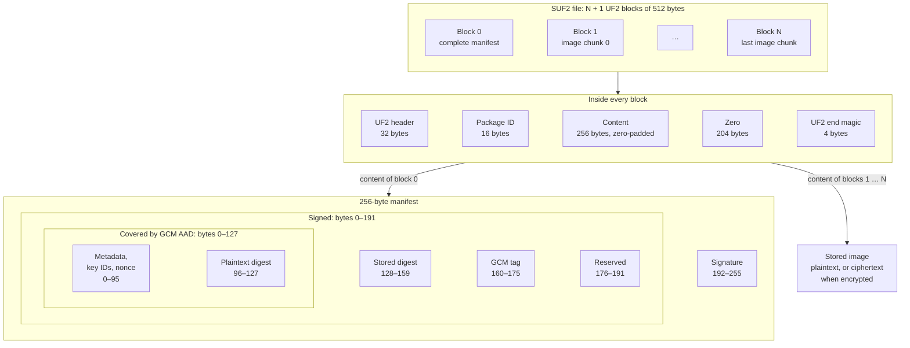

# SUF2 specification

SUF2 (Secured UF2) is UF2 transport plus a signed firmware manifest, with optional encryption. Block 0 holds the complete 256-byte manifest; the remaining blocks carry the image in chunks of 256 bytes. One signature authenticates the manifest and, through its digests, the whole image.

The format uses ECDSA P-256 with SHA-256 for authentication and AES-256-GCM for encryption. There is one format version and no algorithm selection. Tool authors can start with sections 3–7; device authors also need the acceptance and boot rules in sections 8–9.

## 1. Scope

This document defines the package format, the receiver behavior and the check made on every boot. Encryption protects the image in transit only; installed firmware is plaintext. SUF2 does not define a bootloader, a transport other than UF2 blocks, key distribution, or anti-rollback.

The specification answers the threat model in [threat-model.md](reference/threat-model.md); the mapping from threats to specification sections is in [security-design.md](security/security-design.md). It relies on the platform guarantees in [trust-chain.md](reference/trust-chain.md).

## 2. Conventions

Requirement words MUST, MUST NOT, SHOULD and MAY are used in the RFC 2119 sense.

- `u32` is an unsigned 4-byte little-endian integer, as in UF2.
- `bytes[n]` is a string of n bytes, stored and hashed in the order shown. Magic values, identifiers, nonces, digests and tags are byte strings, so endianness does not apply to them. The signature is a byte string that holds two big-endian integers (section 7).
- `x[a..b]` means bytes a to b of `x`, inclusive, and `‖` means concatenation. A quoted string such as `"SUF2-AEAD-V1"` stands for its ASCII bytes, with no terminator.
- Reserved fields and reserved flag bits MUST be written as zero and MUST be rejected if nonzero.
- A receiver MUST reject any value in a SUF2 block or manifest that this document does not define. There is no extension mechanism in v0.1.

Terms:

- **Plaintext image:** the application bytes to be installed.
- **Stored image:** the image bytes carried by the package, excluding padding. These are plaintext in a signed-only package, or AES-256-GCM ciphertext without its tag in an encrypted package. Installed firmware is always plaintext.
- **Producer:** the tool that builds and signs a package.
- **Receiver:** the device code that collects and verifies an update. The **loader** verifies the installed image before starting it.
- **Session:** a receiver's collection of blocks for one package (section 8).
- **Candidate:** the package currently being collected or verified by a session.

## 3. UF2 transport profile

SUF2 keeps the 512-byte block, its 32-bit little-endian header fields and its three magic numbers from the [upstream UF2 specification](https://github.com/microsoft/uf2). A UF2 block is a **SUF2 block** when its `familyID present` flag is set and its family ID is the SUF2 family ID. Every SUF2 block MUST also follow these rules:

| UF2 field | SUF2 rule |
| --- | --- |
| flags | Exactly `not main flash` (0x00000001) and `familyID present` (0x00002000), so the value is 0x00002001 |
| familyID | 0x1E0424ED, the SUF2 family ID. It identifies the format, not an MCU family. |
| targetAddr | 0. It is never a flash destination. |
| payloadSize | 272: a 16-byte package identifier plus 256 content bytes |
| blockNo | Position in the package, 0 to N (section 5) |
| numBlocks | N + 1, where N is the number of image chunks |
| data[0..15] | Package identifier (section 4) |
| data[16..271] | Manifest or image content; unused bytes in the last image block are zero |
| data[272..475] | Zero |

UF2 permits up to 476 payload bytes. Using 272 leaves room for the package identifier while keeping 256-byte image chunks and a one-block manifest. The receiver stages the content; it does not flash the UF2 payload directly.

The family ID was chosen at random, as upstream recommends, and did not appear in the upstream family list when it was chosen. Registering it there is still to do (section 13).

These fields tell compliant legacy UF2 loaders to skip SUF2 blocks. Historical loaders may not honor them, so this is not a compatibility guarantee.

## 4. Package association

Every block starts its UF2 data with the same 16-byte **package identifier**: the first 16 bytes of SHA-256 over the complete 256-byte manifest, including its signature. This lets the receiver detect mixed packages even when image blocks arrive before the manifest. The identifier is a routing label only; acceptance still requires the signature and image checks.

UF2's `blockNo` determines whether the content is the manifest or an image chunk, and its position in the image. The signed image length determines the last chunk's useful length.

## 5. Package layout

A stored image of L bytes is split into N = ceil(L / 256) chunks. The package has N + 1 blocks. Each block's content MUST match its row:

| blockNo | Content | Offset within manifest or image | Useful bytes |
| --- | --- | --- | --- |
| 0 | Complete manifest | 0 | 256 |
| k + 1, for chunk k = 0 … N − 1 | Image chunk k | 256 × k | min(256, L − 256 × k) |

Across the whole package:

- `numBlocks` MUST be N + 1 in every block, with N derived from the signed image length.
- Every block MUST carry the same package identifier, matching the one computed from block 0's manifest.
- The last chunk MUST be zero-padded to 256 bytes. Padding is not part of the image and is excluded from its digests and GCM input.

For example, a 257-byte image needs two chunks, so its package has three blocks, 1,536 bytes in all:

| blockNo | Content | Offset | Useful bytes |
| --- | --- | --- | --- |
| 0 | manifest | 0 | 256 |
| 1 | image | 0 | 256 |
| 2 | image | 256 | 1 |

The exact file size is 512 × (ceil(L / 256) + 1) bytes: about twice the image size, plus one manifest block and last-chunk padding.

Producers SHOULD emit blocks in ascending order. Receivers MUST accept any order.

## 6. Manifest (256 bytes)

| Group | Offset | Type | Field |
| --- | --- | --- | --- |
| Format | 0 | bytes[8] | Manifest magic, ASCII `SUF2MFST` (53 55 46 32 4D 46 53 54) |
| Format | 8 | u32 | Format version = 1 |
| Format | 12 | u32 | Flags: bit 0 = encrypted; other bits reserved |
| Image identity | 16 | bytes[16] | Product identifier |
| Image identity | 32 | u32 | Load address: intended execution base |
| Image identity | 36 | u32 | Image length, L |
| Keys and nonce | 40 | bytes[16] | Signing-key identifier |
| Keys and nonce | 56 | bytes[16] | Encryption-key identifier |
| Keys and nonce | 72 | bytes[12] | AES-GCM nonce |
| Reserved | 84 | bytes[12] | Reserved |
| Digests | 96 | bytes[32] | Plaintext digest: SHA-256 of the plaintext image |
| Digests | 128 | bytes[32] | Stored digest: SHA-256 of the stored image |
| Encryption | 160 | bytes[16] | GCM tag |
| Reserved | 176 | bytes[16] | Reserved |
| Signature | 192 | bytes[64] | Signature, `r ‖ s` (section 7) |

Rules:

- L MUST be nonzero. Plaintext and ciphertext have the same length, so only one length is stored. Chunk count and block count are derived from it (section 5).
- Flags MUST be 0 for signed-only or 1 for encrypted. The algorithms are fixed by the format version.
- **Signed-only package:** the encryption-key identifier, nonce and tag MUST be zero, and the two digests MUST be equal, because the stored image is the plaintext image.
- **Encrypted package:** the encryption-key identifier MUST NOT be zero. The stored image is the ciphertext; its tag is kept in the manifest, not appended to the image.
- The load address is the base address at which the plaintext image is intended to be mapped for execution. It is not an entry point or staging address.
- A producer MUST set the load address to the image's intended execution base (its linked base for a fixed-address image).
- The device MUST check the execution base and image length against local policy. That policy selects the physical installation destination; the device MUST NOT write to flash based on the package address alone.

The 28 reserved bytes keep the manifest at a fixed 256 bytes. They MUST remain zero in format version 1. Assigning meaning to either reserved range requires a new format version; this space is not an extension mechanism.

Encryption hides image contents in transit, not the manifest. Product identity, addresses, lengths, key identifiers and digests remain visible. The plaintext digest lets someone confirm a guessed image by hashing it and comparing the result.

### 6.1 Identifiers

- **Product identifier:** an opaque 16-byte value chosen by the vendor for a product or board. The receiver compares it byte for byte with its local policy.
- **Signing-key identifier:** the first 16 bytes of SHA-256 over the public key in uncompressed form, `0x04 ‖ X ‖ Y`, 65 bytes, with X and Y as 32-byte big-endian coordinates. Anyone can compute it from the public key, so no registry is needed. It only selects among keys provisioned on the device; a key carried in a package is never trusted.
- **Encryption-key identifier:** an opaque 16-byte label assigned when the AES key is provisioned. It is not derived from the key. It MUST NOT be all zero and MUST be unique among the keys on one device. Devices sharing an AES key use the same label.
- **Package identifier:** see section 4.

## 7. Cryptographic construction

The signature is the final 64 bytes of the manifest. It signs the preceding 192 bytes together with the SUF2 domain prefix. Those signed bytes contain the firmware digests, so verification checks both the manifest signature and the actual firmware against its signed digest.

AAD (additional authenticated data) is unencrypted data authenticated along with the ciphertext. The `SUF2-AEAD-V1` prefix identifies the GCM AAD; `SUF2-MANIFEST-V1` keeps SUF2 signatures distinct from signatures over other message formats.

The cryptographic inputs are:

- **AAD** = `"SUF2-AEAD-V1"` ‖ `0x00` ‖ manifest[0..127], 141 bytes.
- **Signed message** = `"SUF2-MANIFEST-V1"` ‖ `0x00` ‖ manifest[0..191], 209 bytes.

| Value | Computed from | Stored at |
| --- | --- | --- |
| Plaintext digest | SHA-256 of the plaintext image | manifest[96..127] |
| Ciphertext and tag (encrypted only) | AES-256-GCM of the plaintext image, with the nonce from manifest[72..83] and the AAD | Stored image; tag at manifest[160..175] |
| Stored digest | SHA-256 of the stored image | manifest[128..159] |
| Signature | ECDSA P-256 with SHA-256 over the signed message | manifest[192..255] |
| Package identifier | First 16 bytes of SHA-256 of manifest[0..255] | data[0..15] of every block |

The signature covers all manifest metadata and both image digests. The AAD ties the ciphertext to the metadata and plaintext digest.

Both digests are required. The stored digest checks received bytes before decryption, without needing the AES key. The plaintext digest checks the installed firmware on every boot.

Build the package in this order:

1. Start with 256 zero bytes.
2. Fill the metadata in bytes 0..83, including, for an encrypted package, a fresh nonce at 72..83. Leave reserved bytes zero. Write the plaintext digest to 96..127.
3. If encrypting, encrypt the plaintext image as in the table. The ciphertext becomes the stored image and the tag goes to 160..175. Otherwise the stored image is the plaintext image.
4. Write the stored digest to 128..159.
5. Sign the signed message and write the signature to 192..255.
6. Compute the package identifier and emit the blocks (section 5).

Every value is computed over the exact serialized bytes, never over a re-encoded copy.

**Nonce.** For each AES-GCM encryption invocation, the producer MUST generate a 12-byte nonce with a cryptographically secure random generator and MUST NOT accept a nonce from its user. Repeating a nonce under one AES key exposes plaintext and allows tag forgery.

Under NIST SP 800-38D, the total MUST NOT exceed 2^32 encryption invocations for one key. This lifetime budget is shared across all producers. Count encryptions whose output is discarded and encryptions repeated for a retry; copying an already-created package does not consume another invocation. The provisioning and signing pipeline MUST enforce this shared budget.

**Signature:**

- Hash the signed message once with SHA-256; that hash is the ECDSA input. Implementations MUST NOT hash it twice by passing a hash to a library call that expects a message.
- Store `r ‖ s`, each a 32-byte big-endian integer.
- With n the P-256 group order (`0xFFFFFFFF00000000FFFFFFFFFFFFFFFFBCE6FAADA7179E84F3B9CAC2FC632551`), require 1 ≤ r ≤ n − 1 and 1 ≤ s ≤ (n − 1) / 2. A producer whose library returns a larger s MUST replace it with n − s. A verifier MUST reject values outside these ranges. This low-S rule prevents signature malleability from giving the same signed content a second package identifier.

## 8. Receiver behavior

### 8.1 Sector classification

A receiver classifies each 512-byte sector it is given, such as a write to its virtual drive:

1. If any of the three UF2 magic numbers is wrong, the sector is not UF2. Ignore it.
2. If the `familyID present` flag is clear, or the family ID is not 0x1E0424ED, the block belongs to another format. Ignore it, as upstream UF2 recommends for blocks of other families. A receiver MAY report it as a diagnostic.
3. Otherwise it is a SUF2 block. Apply the rules in sections 3–5 that can be checked without the manifest; defer length-dependent checks until block 0 arrives. Pass the block, including any validation error, to the session (section 8.2).

Ignored sectors never start, change or reset a session. Hosts also write file-system sectors, so ignoring sectors is normal. A SUF2 receiver MUST NOT install firmware from non-SUF2 blocks through a plain-UF2 fallback.

### 8.2 Sessions

A receiver MUST use fixed local limits for image size, block count and staging capacity, checked arithmetic and per-block completeness tracking. Before staging any SUF2 block, it MUST require `numBlocks` to be at least 2 and no greater than the local block limit, and `blockNo` to be less than `numBlocks`. After reset there is no session. The following rules are mandatory:

| State | Event | Action |
| --- | --- | --- |
| No session | First SUF2 block is malformed or out of bounds | Enter failed without staging it |
| No session | First valid SUF2 block | Start collecting its package identifier and `numBlocks`, then process it under the collecting rules |
| Collecting | New valid block with matching identifier and `numBlocks` | Stage it; image blocks may arrive before block 0 |
| Collecting | Identical duplicate | Accept without changing completeness |
| Collecting | Malformed block, conflicting duplicate, different identifier or different `numBlocks` | Fail the session; never switch candidates silently |
| Collecting | Block 0 arrives | Check the manifest, package identifier, derived count and padding of any staged last chunk; enter failed if a check fails |
| Collecting | Every block from 0 to N has arrived | Freeze the candidate, mark complete and verify (section 9); install only if it passes |
| Complete | Candidate verification fails | Enter failed; do not install the candidate |
| Complete | Identical repeated SUF2 block | Ignore it without changing the candidate or reporting an error |
| Complete | Any other SUF2 block | Report and drop it without changing the candidate or interrupting verification or installation |
| Failed | Any SUF2 block | Report and drop it until a local reset |

Every transition into failed MUST report its cause to the host through the receiver's documented status or error mechanism. A session that fails before installation MUST leave the installed application unchanged.

A local reset is a link disconnect, re-enumeration, reboot, timeout or local command. It discards a collecting or failed session. Nothing in a block can reset a session, and a timeout or file close MUST NOT establish completeness or authorize installation. Installation already under way follows the platform's interruption rules (section 10). A receiver MAY re-enumerate after reporting a failure so the user can copy the file again.

## 9. Verification

### 9.1 Candidate verification

Before installing a complete candidate, the receiver MUST make these checks in order and reject the package at the first failure:

1. **Structure:** every rule in sections 3 to 6, including the package identifier recomputed from the manifest and, for a signed-only package, equal digests.
2. **Local policy:** product identifier, permitted execution base and image size, and whether encryption is required (section 9.3).
3. **Signature:** select the provisioned signing key with a matching identifier, or reject if there is none. Verify the signature, including the range checks in section 7.
4. **Stored digest:** hash the staged stored image and compare it with manifest[128..159]. For a signed-only package this also proves the plaintext digest, because the two digests are equal.
5. **Encrypted packages only:** select the provisioned AES key with a matching label, or reject if there is none. Verify the GCM tag over the ciphertext and AAD, then compare the SHA-256 of the decrypted image with the plaintext digest. Decrypted bytes MUST NOT be installed or exposed until both checks pass.

A failure MUST NOT fall back to a weaker mode, such as treating an encrypted package as signed-only.

Staging and decryption storage are platform choices; they MUST preserve these checks and the verified bytes through installation. Implementation guidance belongs in [design-guidelines.md](security/design-guidelines.md#2-stage-verify-then-install).

### 9.2 Boot verification

The loader retains the exact 256-byte manifest at a platform-defined location associated with the installed plaintext image; physical adjacency is not required. Before every start of the application, it MUST:

1. Check that the manifest follows section 6.
2. Check the product identifier, execution base and size against local policy.
3. Verify the signature with the provisioned signing key selected by its identifier, including the range checks in section 7.
4. Hash exactly the first L bytes of the installed plaintext image, excluding flash padding, and compare the result with the plaintext digest.

If any step fails, the loader MUST NOT start the application and MUST enter recovery.

The stored digest, encryption-key identifier, nonce and tag are not compared with transit data again, because that data no longer exists. Their structure is checked with the rest of the manifest, and the signature still covers them. The encryption requirement (section 9.3) applies when a package is accepted, not at boot. The platform MUST also keep the checked bytes unchanged until they run; see [trust-chain.md](reference/trust-chain.md#2-requirements-for-a-verified-boot-claim).

### 9.3 Encryption policy

A receiver MAY be configured to require encryption. A signed-only package is then rejected. An encrypted flag is never evidence of authenticity: the signature check still applies.

## 10. Installation (informative)

Installation is platform-specific and outside the portable core. The recommended pattern is stage, verify, journal, copy in bounded steps, verify the installed bytes, then reboot. See [design-guidelines.md](security/design-guidelines.md).

## 11. Versioning

The manifest's format version identifies the entire SUF2 format: block layout, manifest layout and fixed algorithms. A receiver MUST reject versions it does not implement. After publication, changing any layout, algorithm or constant requires a new format version. Devices do not gain support for future versions automatically.

Format version 1 is a wire-format value, not the documentation or release version. The v0.1 release profile is still a draft; its earlier layouts are superseded by this one.

## 12. Explicit non-features in v0.1

Anti-rollback or security counters, timestamps as authorization, extensible tags, compression, sparse or multi-component images, bootloader self-update, public-key recipient wrapping, key distribution, and encryption at rest.

## 13. Open items

The format uses the fixed manifest described here rather than wrapping an MCUboot image; the rationale is in [why-suf2.md](why-suf2.md#why-a-fixed-manifest). Before freezing, review this layout independently and publish test vectors. The remaining implementation and integration work does not add format fields:

| Task | Notes |
| --- | --- |
| Register the family ID | Add 0x1E0424ED to the upstream UF2 family list |
| Test vectors | Publish signed-only and encrypted packages with their intermediate values |
| Per-boot SHA-256 cost | Measure on Cortex-M0+ for large images |
| P-256 verification cost and footprint | Measure on RP2040 with a pinned crypto library |
| Decryption storage in the reference loader | Choose a staging strategy that preserves section 9's checks and interruption safety |
